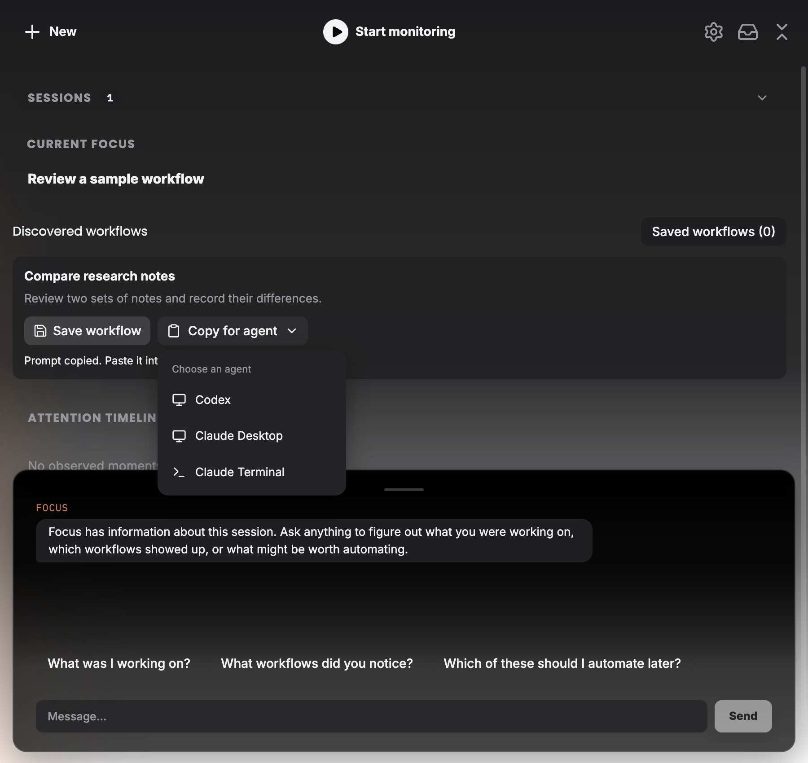

<p align="center">
  
</p>

<h1 align="center">Focus</h1>

<p align="center"><strong>Find your next Claude or Codex use case in the work you already do.</strong></p>

<p align="center">macOS · Bring your own AI key · Local storage · MIT licensed</p>

<p align="center">
  <a href="#get-started">Get started</a> ·
  <a href="docs/getting-started.md">User guide</a> ·
  <a href="docs/privacy.md">Privacy</a> ·
  <a href=".github/CONTRIBUTING.md">Contribute</a> ·
  <a href="https://github.com/underdoginnovationinc/Focus/issues">Report an issue</a>
</p>

Focus is a Mac app that uses screenshots and app context to understand a work session, identify
repeated workflows, and turn useful ideas into prompts for coding agents. Save a workflow, then
copy it into Codex, Claude, or another assistant to start building.

<p align="center">
  
  <br />
  <em>A sample workflow in Focus, ready to save or hand off to an agent.</em>
</p>

## What you can do

- **Discover automation ideas.** Capture a session and review the patterns Focus notices in your work.
- **Ask about the session.** Chat about what you were doing, compare its interpretation with your intent, and explore possible next steps.
- **Keep useful workflows.** Save prompts in a local Workflow Inbox, independent of the original session.
- **Build with your preferred agent.** Use **Copy for agent** to choose Codex, Claude Desktop, or Claude Terminal.
- **Choose your AI provider.** Use your own OpenAI, Anthropic, or Gemini key with a vision-capable model.

Focus observes and suggests. It does not automatically perform the workflows it discovers.

## Get started

**Currently available from source on macOS.** There is no packaged installer yet.
You need **Node 24**, **pnpm 11.7.0**, and an API key from one supported provider.

```bash
git clone https://github.com/underdoginnovationinc/Focus.git
cd Focus
pnpm install --frozen-lockfile
pnpm dev:desktop
```

1. Open **Settings**, save your API key, and select a model from that provider.
2. Grant Electron **Screen Recording** and **Accessibility** permissions when prompted.
3. Press **Start monitoring** and work normally for a few minutes.
4. Press **Stop**, review the report, and save a useful workflow.
5. Choose **Copy for agent**, then bring the prompt into Codex or Claude.

Codex and Claude Desktop handoffs copy the prompt and open the installed app; paste it into the
project or chat you want. Claude Terminal starts the installed `claude` CLI with the prompt.
You can also copy a saved prompt for any other assistant.

See the [user guide](docs/getting-started.md) for setup, permissions, storage locations, and handoffs.

## Ideas to explore

| Your work session                      | An automation idea to discuss with your agent               |
| -------------------------------------- | ----------------------------------------------------------- |
| Comparing research sources             | A script that collects links and creates a comparison table |
| Repeating a browser checklist          | A browser workflow that checks the same steps for you       |
| Reviewing dashboards and writing notes | A tool that turns exported data into a recurring summary    |

These are examples to explore. Focus's suggestions depend on the context it captures and the model you select.

## Your data and your key

Sessions, screenshots, reports, and saved workflows live on your Mac. API keys are encrypted using
Electron's secure storage. **There is no Focus account, maintainer-operated backend, or product tracking.**

AI features send relevant screenshots and session context directly to your chosen provider, using
your key. Provider API usage costs money and follows that provider's data policies. Focus is not an
offline AI app. Local history and screenshots are not encrypted by Focus.

Read the [privacy and data-flow guide](docs/privacy.md) for exactly what is stored and sent.

## Explore the project

| Guide                                           | What it covers                                              |
| ----------------------------------------------- | ----------------------------------------------------------- |
| [Getting started](docs/getting-started.md)      | Setup, permissions, saving workflows, and agent handoff     |
| [Privacy](docs/privacy.md)                      | Local storage, API keys, provider requests, and deletion    |
| [Architecture](docs/implementation-overview.md) | Electron, React, SQLite, LangChain, and Deep Agents         |
| [Development](docs/development.md)              | Repository layout, build commands, and testing              |
| [Design rationale](docs/design.md)              | Why Focus uses attention and screenshots to understand work |
| [Contributing](.github/CONTRIBUTING.md)         | Bug reports, feature ideas, and pull requests               |

## Open source

Built by [Underdog Innovation Inc.](https://github.com/underdoginnovationinc).
Focus is [MIT licensed](LICENSE): use it, inspect it, modify it, and share it.

Have an idea or found a bug? [Open an issue](https://github.com/underdoginnovationinc/Focus/issues/new/choose).
For sensitive security reports, see the [security policy](.github/SECURITY.md).
