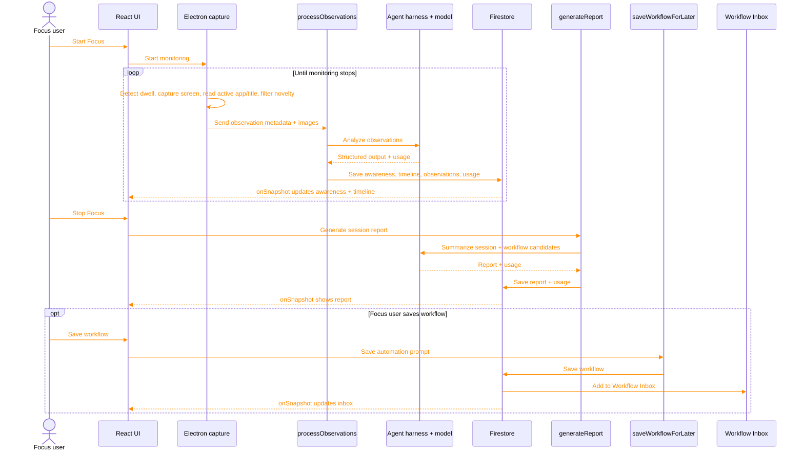

# Focus
**An agent that watches your attention, explains your work, and spots what to automate.**


Focus is a quiet observer for your own work. During a real session it watches where your attention
lands on screen, builds a live theory of what you're doing, and afterward tells you: here is what you
worked on, here are the patterns I noticed, and here are the repetitive parts that might be worth
automating.

The key philosophy is _understanding before action_. Focus watches and thinks; it does not click,
type, edit files, or change anything on your computer. When it finds something worth automating, it
packages the workflow into a ready-made prompt you can save to your **Workflow Inbox** or hand off to
Claude Desktop/CLI to build.

Read more about the rationale for the work:
[Focus rationale](https://docs.google.com/document/d/1_J81AX0jKFAsakXlRQGSFJ6o1jm_Qr869qVEz-GmeEs/edit?usp=sharing)

## How it works

1. **It watches attention, not everything.** Focus waits for brief mouse pauses, then captures a
   250×250 crop around the cursor, periodic full-screen context frames, the active app, and the
   window title. A perceptual-hash novelty filter drops near-duplicate frames.
2. **It builds a running theory.** Small batches of observations go to a server-side agent harness
   and model, which maintain living session notes: `/hypothesis.md` for the current best explanation
   and `/workflows.md` for repeated patterns and automation ideas.
3. **It shows its understanding live.** The React UI streams session state from Firestore, including
   the current hypothesis, confidence, evidence, alternatives, timeline, chat, and token usage.
4. **It writes a report when you stop.** After a session, Focus generates a narrative summary with
   the likely objective, a timeline, telling screenshots, noticed workflows, and next steps.
5. **It hands off automation candidates.** Focus can save automatable workflows to the Workflow Inbox
   and launch a prepared prompt in Claude Desktop or Claude CLI. Focus supplies the context; the
   separate agent does the building.

## Run it

### Prerequisites

- Node 24, `pnpm`, and Firebase CLI v15+ (`npx firebase-tools`).
- Optional for automation handoff: install Claude Desktop and/or Claude Code CLI. Focus can save
  prompts to the Workflow Inbox without them, but the handoff buttons need the Claude Desktop app or
  a `claude` CLI command on PATH to open/send prompts to those platforms.

### Agent setup prompt

Use this prompt with Claude, Codex, or another coding agent when starting from a fresh checkout:

```text
You are helping set up the Focus repo on this machine. Work in the current repository.

Please:
1. Inspect README.md, package.json, firebase.json, functions/package.json, and .nvmrc before making
   changes.
2. Ensure Node 24 is active from .nvmrc. If nvm is installed but not loaded in the shell, source
   ~/.nvm/nvm.sh, then run nvm install && nvm use. If Node 24 is not installed and no version manager
   is available, tell me the exact install command for this machine and stop before making unrelated
   changes.
3. Ensure pnpm matches the packageManager field. Prefer Corepack:
   corepack enable
   corepack prepare pnpm@9.15.9 --activate
   Then confirm node -v and pnpm -v.
4. Ensure Firebase CLI v15+ is available through either the global firebase command or
   npx firebase-tools --version. Do not deploy.
5. Run pnpm install. Allow normal dependency and postinstall binary downloads, including Electron,
   esbuild/tsup, Vite, and Firebase tooling. If a binary download is blocked by network, proxy,
   cache, or permissions, report the failing package, URL or host if visible, and the command that
   failed.
6. Run pnpm build before launching the app. If the build fails, fix only minimal setup/build issues,
   explain the change first, and rerun pnpm build.
7. If Electron fails with "Electron failed to install correctly" or a macOS dyld error about a
   missing "Electron Framework", treat it as a broken local Electron binary install, not application
   code. Try pnpm rebuild electron, then verify Electron from apps/desktop. If needed, remove only
   Electron's broken generated dist/path marker and reinstall/re-extract the Electron package, then
   retry. A healthy macOS Electron dist is hundreds of MB and contains
   Electron.app/Contents/Frameworks.
8. Do not deploy, do not create or change secrets, and do not print secret values. If local model
   credentials are already configured and I ask for the integration check, run:
   pnpm --filter @focus/functions run validate
   Otherwise skip validation and say credentials are required.
9. If the desktop app needs to be smoke-tested on macOS, run pnpm dev:desktop. Confirm the Vite
   renderer is serving on port 5173 and that an Electron window titled
   "Focus — attention-observing agent" opens. Remind me to grant Screen Recording and Accessibility
   permissions when prompted. If checking the renderer in a normal browser, "Connecting to Focus…"
   can be expected because the full app relies on Electron's preload bridge.
10. If testing workflow handoff, confirm Claude Desktop and/or Claude Code CLI are installed locally.
   Focus can save automation prompts without them, but opening/sending a prompt to Claude requires
   the Claude Desktop app or a `claude` CLI command on PATH.
11. Report the Node, pnpm, and Firebase CLI versions, the commands you ran, whether install/build/app
   launch passed, and any remaining blockers.

Do not modify application code unless a setup or build failure requires a minimal fix. Explain any
code/config change before making it.
```

### Manual setup

```bash
pnpm install

# Build everything
pnpm build
```

### Run the desktop capture app (macOS)

```bash
pnpm dev:desktop
```

Grant **Screen Recording** and **Accessibility** to Electron in
_System Settings → Privacy & Security_ the first time (the cursor‑region screenshots and the active
window title need them). Then press **Start Focus**, work for a bit, and press **Stop Focus** to chat
while the session report generates automatically.

## Demo use case

A simple way to try the whole loop is a short news-browsing session:

1. Press **Start Focus**.
2. Visit 3-5 news sites and browse normally for a few minutes: scan headlines, open articles,
   compare coverage, search, and switch between tabs.
3. Press **Stop Focus** and wait for the session report to generate automatically.
4. Review what Focus thinks you were doing, including any repeated workflows it noticed.
5. If the report or Workflow Inbox includes an automation-ready workflow, click the Claude handoff to
   launch the prepared prompt immediately. Claude Desktop or Claude Code CLI must be installed for
   those handoff buttons to open/send the prompt.

This shows the intended shape of the product: Focus observes and explains the browsing workflow,
then packages any repetitive follow-up work for a separate agent to build.

## Architecture



- **Electron** captures dwell moments locally and tags novelty with a perceptual hash before
  anything leaves the machine.
- **Cloud Functions** run the agent server‑side so the model key is never in the client.
- **Firestore** stores sessions/observations/chat/reports/saved workflows and streams live updates
  to the UI.
- **Two‑speed loop:** monitoring is throttled + batched (medium thinking); chat is unthrottled
  (medium); the report uses high thinking. See `packages/shared/src/monitoringConfig.ts`.
- **Workflow handoff:** Focus saves automation prompts and opens Claude Desktop/CLI when installed;
  the automation work happens outside Focus.

## Repo layout

| Path                    | What                                                           |
| ----------------------- | -------------------------------------------------------------- |
| `packages/shared`       | Types, Zod schemas, monitoring config (shared by all packages) |
| `functions`             | Cloud Functions + the agent harness (`functions/src/agent`)    |
| `apps/desktop`          | Electron app, native capture, and the nested React renderer    |
| `apps/desktop/renderer` | Vite renderer loaded by the Electron shell                     |

## Testing

Automated tests are deterministic and do **not** call Gemini or Deep Agents. They require no model
provider secrets; agent/model responses are mocked with fixed fixtures.

```bash
pnpm test:unit   # Vitest: shared logic, Functions helpers, Electron logic, renderer UI
pnpm test:rules  # Firestore + Storage rules against local Firebase emulators
pnpm test:e2e    # Playwright against the mocked Vite renderer harness
pnpm test:ci     # Unit + rules + mocked e2e, no secrets required
pnpm coverage    # Coverage for unit-test projects
pnpm build       # Type-check and build shared, Functions, renderer, and Electron shell
```

Coverage thresholds are enforced per layer: shared and Functions logic target 90% statements and
branches; renderer and Electron logic target 80%.

For an optional manual check of the live agent/model integration, provide the Gemini secret value to
the validation script in your shell, then run:

```bash
GEMINI_API_KEY=... \
pnpm --filter @focus/functions run validate
```

That validation script is intentionally separate from `pnpm test:*` because it calls the live
provider API and can depend on quota, network, and credentials.

For native macOS capture behavior, run the desktop app and do a short manual smoke session:

1. Grant **Screen Recording** and **Accessibility** to Electron when prompted.
2. Start monitoring and confirm real cursor crops/full-screen context frames appear in the timeline.
3. Confirm active app/window metadata is captured.
4. Stop monitoring and confirm the report flow starts from the real desktop app.
5. Save a workflow candidate and confirm Claude handoff copies/sends the prompt when Claude Desktop
   or Claude Code CLI is installed locally.

## Deploy

Deploying backend updates requires a Firebase project on the **Blaze** plan because Cloud Functions
and Secret Manager require it.

```bash
pnpm run deploy          # functions + firestore rules + storage rules
pnpm run deploy:functions
```

## Notes

- Model calls use per-role thinking settings; token usage (including thinking tokens) is tracked per
  call and aggregated per session, shown live in the UI.
- Chat model calls are traced from the server-side Functions path when tracing is configured, and
  answer quality is evaluated with an LLM-as-judge check for whether the response matches the
  user's question.
- License: MIT.
